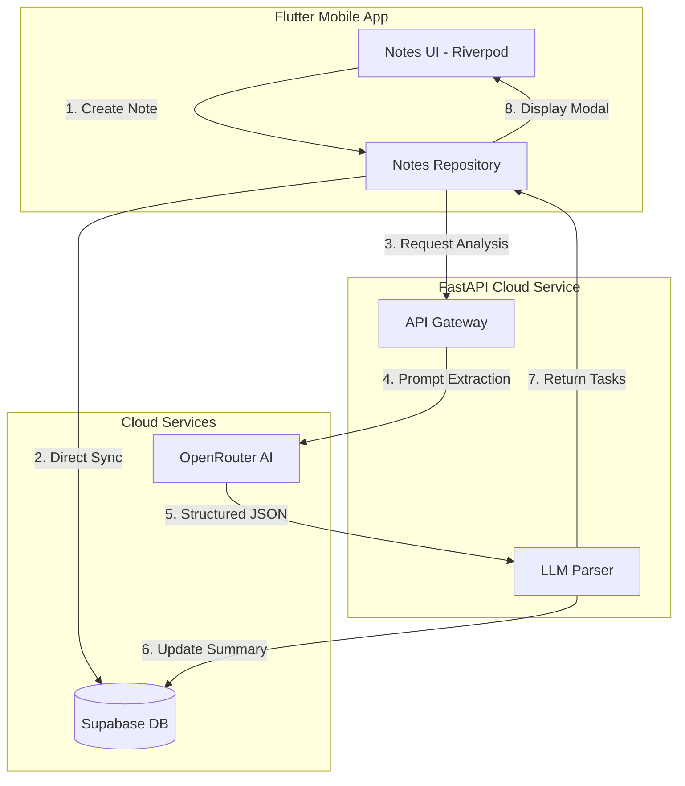

# 🧠 PocketAI — Mobile Task Intelligence Monorepo

> Cross-platform Flutter application backed by an asynchronous Python (FastAPI) microservice that transforms unstructured thoughts into actionable workflows using LLMs and Supabase.

---

## 🚀 Live Services & Documentation

- 🌐 **Production API (Swagger Docs):** [https://pocket-ai-backend.onrender.com/docs](https://pocket-ai-backend.onrender.com/docs)
- 📡 **Service Health Check:** [https://pocket-ai-backend.onrender.com/](https://pocket-ai-backend.onrender.com/)

---

## 🌟 Executive Overview

**PocketAI** bridges mobile note-taking and structured task management. Instead of requiring users to manually format to-do lists, users write unstructured thoughts or meeting notes. The system delegates natural language understanding to a decoupled Python AI microservice, which synthesizes an executive summary and extracts concrete action items with real-time database persistence.

### Key Highlights
- **Decoupled Monorepo:** Clean separation between mobile client (`mobile/`) and cloud API service (`backend/`).
- **Resilient AI Pipeline:** Zero-downtime free-tier LLM inference with OpenRouter fallback routing.
- **Enterprise-Grade DB:** Supabase PostgreSQL with sanitized URL handling and Row Level Security (RLS).
- **Reactive UI:** State management powered by Riverpod with modern Material 3 bottom-sheet interaction.

---

## 🏗️ System Architecture



---

## 📂 Repository Structure

```text
pocket-ai-app/
├── mobile/                        # Flutter Client Workspace
│   ├── lib/
│   │   ├── core/                  # Global utilities, theme & network configs
│   │   └── features/
│   │       └── notes/             # Clean Architecture Module
│   │           ├── data/          # Supabase & HTTP Repository implementations
│   │           ├── domain/        # NoteModel & Entity definitions
│   │           └── presentation/  # Riverpod Providers & Screen Widgets
│   ├── pubspec.yaml               # Flutter dependencies (Riverpod, Supabase, Dotenv)
│   └── .env.example               # Client-side environment template
│
├── backend/                       # Python Microservice Workspace
│   ├── main.py                    # FastAPI entrypoint, CORS & LLM orchestration
│   ├── requirements.txt           # Production dependencies (FastAPI, Uvicorn, OpenAI, Supabase)
│   └── .env.example               # Server-side environment template
│
├── .gitignore                     # Unified root filter for Dart & Python artifacts
└── README.md                      # Monorepo technical documentation
```

---

## 🌐 Primary API Specification

`POST /api/v1/analyze-note`

### Request Payload:
```json
{
  "note_id": "3f7a1b2c-98d4-4a2e-8e4a-b5d123456789",
  "content": "Emergency meeting tomorrow at 9:00 AM with client. Must polish Flutter screen, check environment variables, and submit metrics report before 2:00 PM."
}
```

### Response (200 OK):
```json
{
  "summary": "Urgent client meeting scheduled tomorrow at 9:00 AM to review the mobile application. Key deliverables include Flutter UI adjustments and submitting the metrics report before 2:00 PM.",
  "action_items": [
    "Finalize Flutter screen refinements",
    "Audit production environment variables",
    "Submit metrics report prior to 2:00 PM"
  ]
}
```

---

## ⚙️ Getting Started

### Prerequisites
- **Flutter SDK:** 3.40+ (Dart 3.5+)
- **Python:** 3.12+ (Compatible through 3.15)
- **Supabase Account:** Free PostgreSQL instance

---

### 1. Backend Service Setup

```bash
cd backend

# Create and activate virtual environment
python -m venv .venv
# On Windows PowerShell:
.\.venv\Scripts\Activate.ps1

# Install production dependencies
pip install -r requirements.txt

# Start development server
uvicorn main:app --reload --host 0.0.0.0 --port 8000
```

---

### 2. Mobile Client Setup

```bash
cd ../mobile

# Install packages
flutter pub get

# Run application
flutter run -d chrome
```

---

## 💡 Engineering Highlights & Decisions

1. **Platform-Aware Network Routing:**
   In development, Android emulators isolate loopback requests. The client dynamically resolves the gateway host (`10.0.2.2` on Android vs. `localhost` on Web) preventing `SocketException (OS Error 111)` without manual configuration.
2. **Defensive JSON Extraction:**
   LLMs occasionally inject conversational markdown blocks. The backend includes an index-bounded substring extractor that guarantees valid JSON serialization even across edge-case completions.
3. **Zero-Cost High-Availability Infrastructure:**
   Leverages OpenRouter's dynamic free router coupled with Render's on-demand instances, delivering production capability with $0 recurring cloud overhead.

---

## 👨‍💻 Author

**Luis Urdaneta** — Full-Stack Developer (Python & Flutter)  
*Based in Venezuela • Available for Remote Roles & Contract Work worldwide.*

- **GitHub:** [@Lifimastar](https://github.com/Lifimastar)
- **LinkedIn:** [linkedin.com/in/lifimastar](https://www.linkedin.com/in/lifimastar/)
- **Email:** luisfernand2000@gmail.com
